

  

  
  
  

<h3 align="center" dir="rtl">استوديو ذكاء اصطناعي كامل… يشتغل على جهازك أنت.</h3>

صور، فيديو بصوته، أفلام، إعلانات، موشن جرافيك، تصميم، مانقا، بودكاست و3D — بدون اشتراك، بدون سحابة، وبدون ما تطلع ملفاتك من جهازك.

 

## ✦ ليش إبداعي؟

| | |
|---|---|
| 🖥️ **على كرتك أنت** | كل التوليد يصير على كرت الشاشة حقك. ما فيه رصيد ينتهي ولا حد للصور. |
| 🔌 **أي موديل** | حمّل أي موديل صور أو فيديو — FLUX، Qwen-Image، Wan، LTX، MiniMax… — ويشتغل بكل الاستوديوهات. |
| 🇸🇦 **عربي من أول يوم** | الواجهة بالعربي، الذكاء يكلمك نجدي لو تبي، والنصوص العربية تنكتب بخط حقيقي واضح. |
| 🧠 **ذكاء يفهمك** | قل له وش تبي بكلامك — يخطط، يكتب الأوصاف، ويشغّل الأدوات المناسبة بنفسه. |
| 🔒 **ملفاتك لك** | مشاريعك ومحادثاتك وصورك تبقى على جهازك. |

---

## 🎨 جولة في الاستوديو

### الرئيسية — اصنع أي شي بسطر واحد
اكتب الفكرة، اختار الموديل، واضغط ولّد. ونفس الشريط تلقاه بكل الشاشات. وتحته مئات القوالب الرسمية من ComfyUI جاهزة بضغطة.

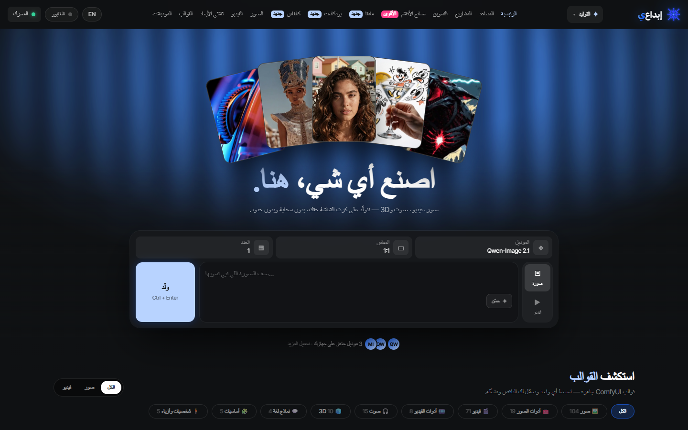

### 🛍️ التسويق — حوّل أي منتج لمحتوى جاهز للنشر
اختار قالب من **50 قالب** مع أمثلة حقيقية، حط صورة منتجك (أو رابطه من المتجر — يسحب الاسم والصور بنفسه)، وأضف موديل من **مكتبة الأفاتارات** لو تبي:
صور منتج، لايف ستايل، موديلز ماسكين المنتج، بوسترات، صور متجر (أمازون ونون)، تغليف، وإعلانات فيديو UGC.

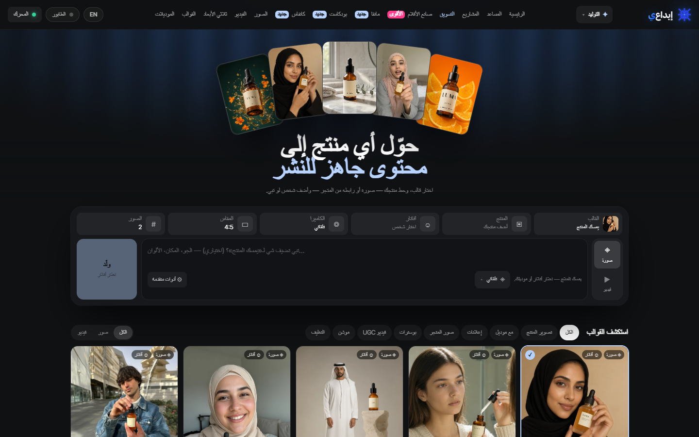

**🎯 زاوية الكاميرا بثلاث حلقات** — اسحب الكاميرا حول منتجك: الحلقة الزرقاء للدوران، الذهبية للارتفاع، والوردية للميلان. أو اختار زاوية جاهزة (¾، جانبي، من تحت، من فوق تماماً) والمسافة (ماكرو، قريب، واسع) — وكل صورة تنصوّر من هالزاوية بالضبط.

**✍️ نص بخط حقيقي** — نص البوستر ما يكتبه موديل الصور (اللي يخربط الحروف)؛ الصورة تترك له مكان، والتطبيق يكتبه بخط ثمانية — واضح ومكتوب صح دايماً.

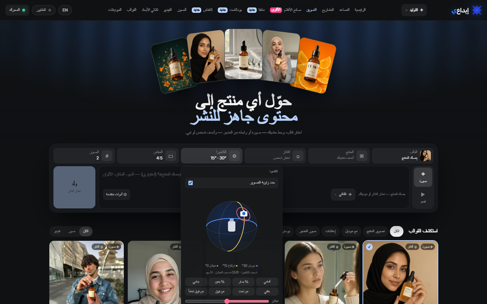

### 🎬 صانع الأفلام — خلّ قصتك تنبض بالحياة
تحكّم بكل تفصيلة: النوع، الحقبة، الكاميرا والعدسة، **أكثر من 30 حركة كاميرا**، **50 لوحة ألوان**، والإضاءة. سوّ **عناصرك** (شخصيات وأماكن) واستدعها بـ `@` مع مشاعرها. لقطة وحدة أو مشهد متعدد لين 30 ثانية — أو **«من سيناريو»** يكتب الفيلم كامل ويقسّمه لقطات، وبعدها مونتاج.

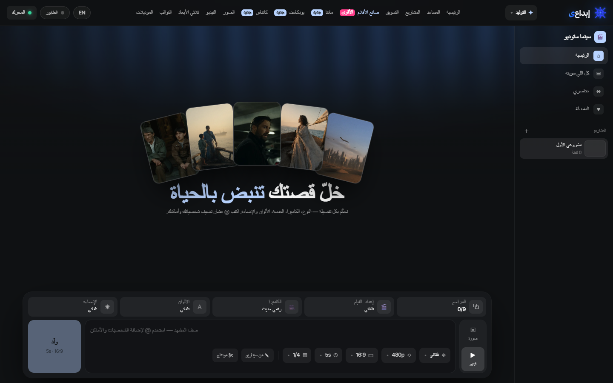

### ⬡ الكانفاس — ابنِ خط إنتاجك عقدة بعقدة
لوحة لا نهائية: وصف ← صورة ← تعديل ← فيديو، كل موديل عقدة. شغّل عقدة وحدة أو السلسلة كلها، وقارن النتائج جنب بعض.
**✦ مساعد الكانفاس:** اشرح وش تبي — «صورة منتجي ← ٣ إعلانات أقارنها ← فيديو لأفضل وحدة» — وهو يبني اللوحة ويكتب الأوصاف ويوصّلها. وتقدر تطلب منه يعدّلها بعدين.

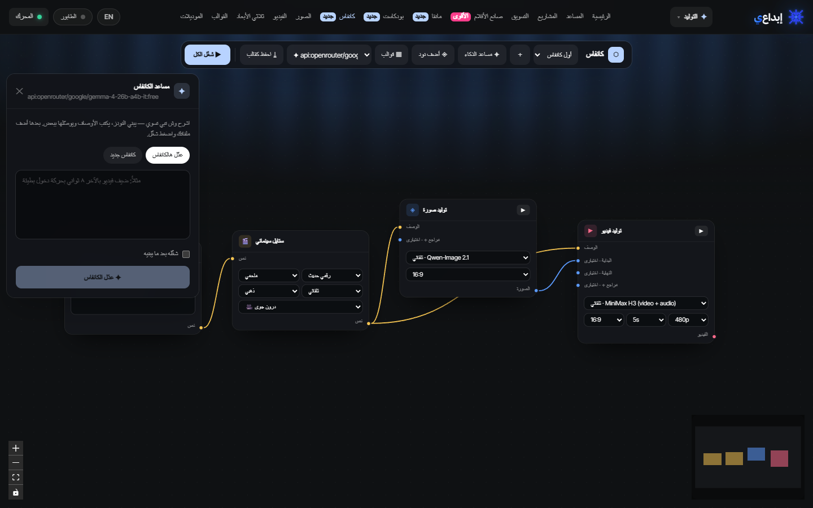

### 🧠 المساعد والمشاريع — مخرجك الذكي
قل له النتيجة اللي تبيها — إعلان، شخصية، مشهد — يخطط ويختار الموديل ويشغّل. يشوف **أكثر من صورة** بنفس الرسالة، يكلمك **بصوتك**، ويقدر يسوي صور تسويق بزوايا كاميرا، يرسم شعارات فيكتور، ويفتح لك أي استوديو وكل شي جاهز فيه.
وكل **مشروع** له ملفاته وشاته الخاص، وزر لكل استوديو، و«افتح في ▾» على أي ملف.

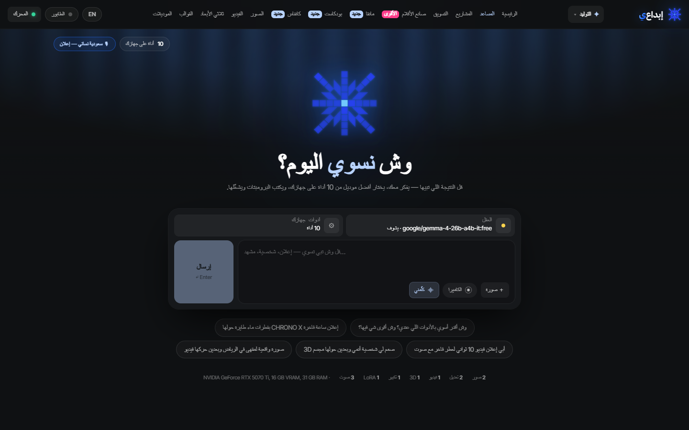

### ✦ المؤثرات — موشن جرافيك ومؤثرات بصرية
محرر موشن كامل (مبني على EffectCraft) والذكاء جنبك: **صف المشهد** وش فيه، و**صف الحركة** كيف تتحرك — ويبني الطبقات والحركات بنفسه. 26 حركة جاهزة تطبقها على أي طبقة، تعابير، وصوت — وتصدير MP4 سريع على كرتك.

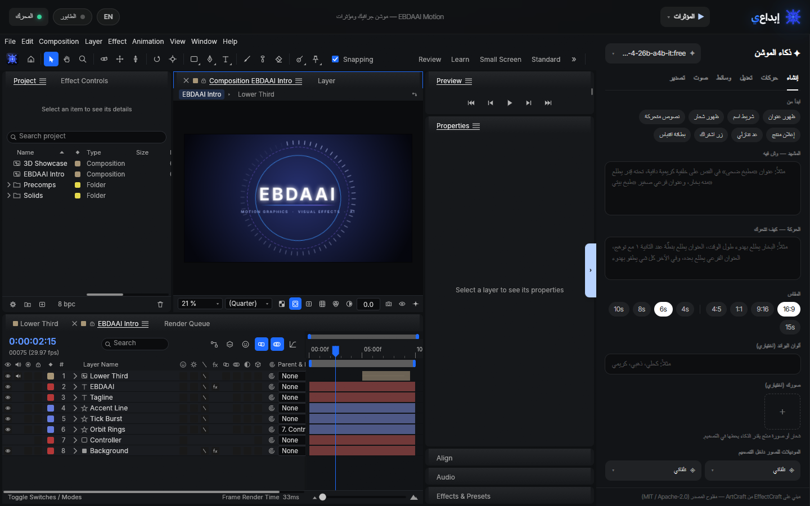

### ◆ التصميم — تصميم فيكتور بالذكاء
شعارات، أيقونات، بوسترات، ملصقات، نقشات وإنفوجرافيك كـ **فيكتور تقدر تعدّله** (مبني على VectorCraft). ولّد صورة بأي موديل وحطها بتصميمك، أو حدد جزء وقل للذكاء وش يغيّر فيه.

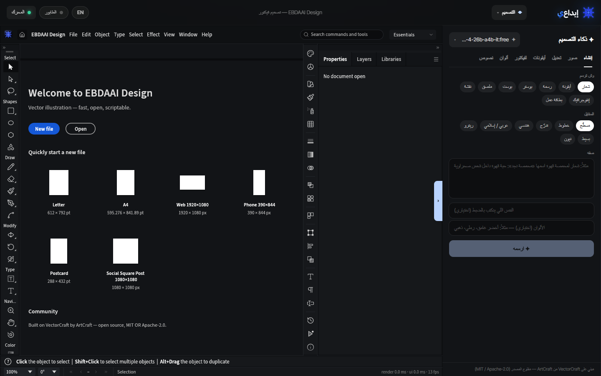

### 🎥 الفيديو، الصور و3D
- **فيديو بصوته:** كلام، مؤثرات وموسيقى بلقطة وحدة (MiniMax H3)، من نص أو من صورة بداية ونهاية.
- **الصور:** توليد وتعديل بمراجع متعددة، تكبير، وإزالة خلفية.
- **3D:** صورة ← مجسم ثلاثي الأبعاد GLB تقدر تلفّه وتشوفه.

<table>
<tr>
<td width="50%">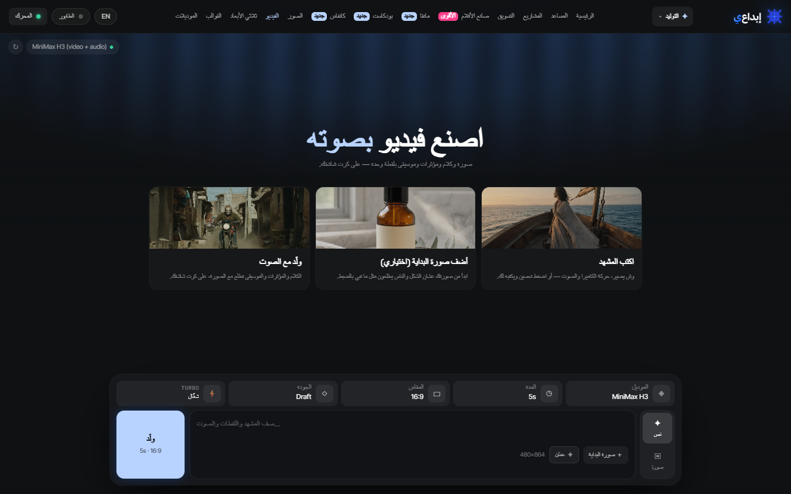</td>
<td width="50%">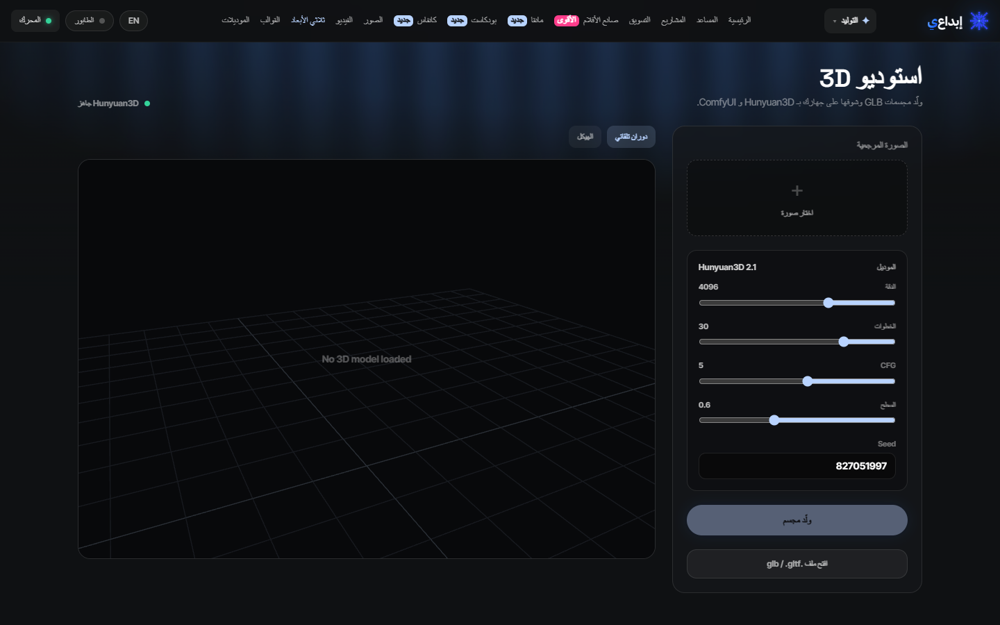</td>
</tr>
</table>

### ✎ المانقا · 🎙 البودكاست · ▦ القوالب · ⬇ الموديلات
- **مانقا:** من فكرة قصة لصفحات جاهزة بالكادرات والفقاعات — تصدير PDF وCBZ وويبتون.
- **بودكاست:** اكتب أو خلّه يكتب الحلقة، عطِ كل مقدّم صوت (أصوات سعودية)، ويطلع لك حوار طبيعي.
- **القوالب:** كل قوالب ComfyUI الرسمية — يقولك وش الجاهز عندك ويحمّل لك الناقص.
- **الموديلات:** تصفّح Hugging Face من داخل التطبيق — يقولك وش يناسب كرتك، وتقدر توزّع الموديلات على **أكثر من هارد** (الخفيف على C والثقيل على D).

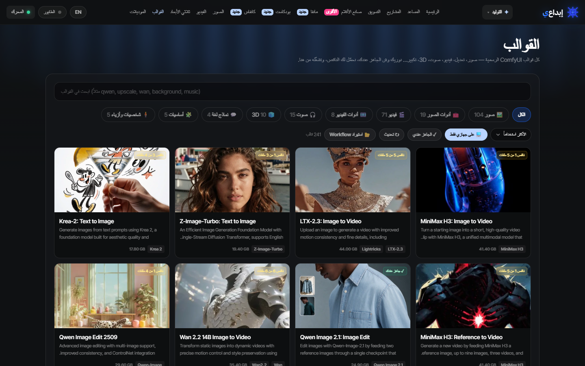

---

## 🖼️ سوّيناها بإبداعي

<table>
<tr>
<td></td>
<td></td>
<td>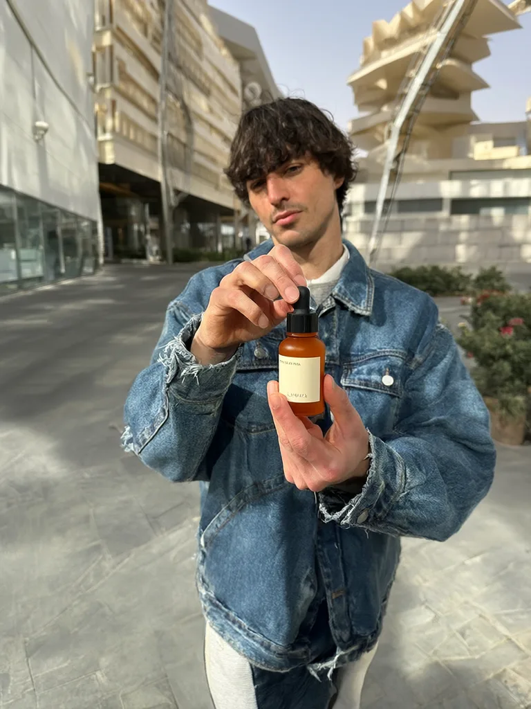</td>
<td></td>
</tr>
<tr>
<td>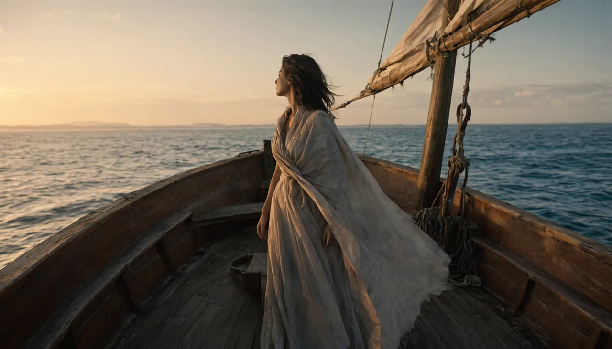</td>
<td></td>
<td></td>
<td>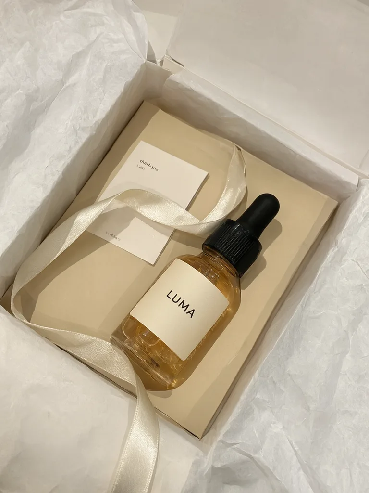</td>
</tr>
</table>

---

## ⬇️ التحميل والتشغيل

### Windows — تطبيق كامل
1. حمّل **[EBDAAI-Setup.exe](https://github.com/mowshcashy/ebdaai-releases/releases/latest)** من آخر نسخة وافتحه.
2. أول تشغيل: يجهّز المحرك (ComfyUI) لحاله، واختار «العقل» والموديلات المقترحة — دقيقتين وتبدأ.
3. **التحديثات تلقائية:** التطبيق يفحص كل كم ساعة، ولما تنزل نسخة جديدة تطلع لك بطاقة «حدّث الحين».

### macOS — تطبيق (Apple Silicon)
1. ثبّت **ComfyUI** (مثلاً [Comfy Desktop](https://www.comfy.org/download)) وشغّله، و **Ollama** اختياري.
2. حمّل **`EBDAAI-macOS-<النسخة>.dmg`** من [آخر نسخة](https://github.com/mowshcashy/ebdaai-releases/releases/latest)، افتحه، واسحب EBDAAI لمجلد Applications.
3. أول مرة لو قال الماك إنه ما يقدر يتحقق منه: الإعدادات ← الخصوصية والأمان ← «افتح على أي حال».

ما يحتاج Node.js — موجود داخل التطبيق. لأجهزة M1 وما بعده، وmacOS 13 أو أحدث. **التحديثات تلقائية:** لما تنزل نسخة جديدة تطلع لك بطاقة «حدّث الحين» داخل التطبيق (أو من القائمة: EBDAAI ▸ التحقق من التحديثات).

### macOS — سيرفر محلي (بديل)
لو تبي تشغّله بالمتصفح بدل التطبيق:
1. ثبّت **Node.js 20+** و **ComfyUI** (مثلاً Comfy Desktop)، و **Ollama** اختياري.
2. حمّل `EBDAAI-macOS-server.tar.gz`، فكّه، واضغط مرتين على `start.command` (أول مرة: كلك يمين ← Open).
3. ينفتح المتصفح على `http://127.0.0.1:3000/studio`.

### المتطلبات
| | الأقل | المقترح |
|---|---|---|
| كرت الشاشة | NVIDIA RTX بـ 8GB | RTX بـ 12–16GB أو أكثر (للفيديو) |
| الذاكرة | 16GB | 32GB |
| المساحة | 40GB | 150GB+ (الموديلات كبيرة — وتقدر تحطها على هارد ثاني) |
| النظام | Windows 10/11 | Windows 11 |

> **موديلات مقفلة؟** بعض الموديلات (مثل LTX-2.5 و FLUX dev) تحتاج موافقة على رخصتها في Hugging Face. افتح القالب، اضغط «وافق على الرخصة»، وحط توكن Hugging Face مرة وحدة — وبعدها يتحمّل عادي.

---

## ❓ أسئلة سريعة

<b>هل يحتاج إنترنت؟</b>

التوليد كله على جهازك. الإنترنت تحتاجه بس لتحميل الموديلات أول مرة، وللتحديثات، ولو اخترت «عقل» سحابي.

<b>هل فيه اشتراك؟</b>

ما فيه اشتراك ولا رصيد للتوليد — كل شي يشتغل على جهازك. وتقدر لو تبي تربط موديلات سحابية مدفوعة (Kling، Seedance، Wan) بمفاتيحك.

<b>أقدر أستخدم موديلاتي اللي عندي؟</b>

إيه — أي موديل في مجلد ComfyUI يظهر بكل الاستوديوهات، وتقدر تضيف أكثر من مجلد على أكثر من هارد من الإعدادات ← التخزين.

<b>وين تنحفظ أعمالي؟</b>

بالمعرض داخل التطبيق، وفي مجلد تختاره أنت من الإعدادات ← التخزين.

---

<b>English</b>

**EBDAAI** is a full AI studio that runs on your own PC: images, video with sound, films, marketing content, motion graphics, vector design, manga, podcasts and 3D — no subscription, no cloud, your files stay on your machine.

- **Any model** — FLUX, Qwen-Image, Wan, LTX, MiniMax… work in every studio.
- **Marketing** — 50 templates with examples, product import from a store link, an avatar library, a three-ring camera-angle gizmo, and poster text drawn with a real font.
- **Cinema Studio** — film setup, 30+ camera moves, 50 palettes, lighting, `@` cast & locations, multi-shot up to 30 s, script-to-film and edit.
- **Canvas** — a node board for multi-model pipelines, with an AI assistant that builds the board from a description.
- **Assistant & Projects** — an AI director that plans and runs the tools, sees several images, talks by voice, and opens any studio with everything filled in.
- **Effects & Design** — embedded motion-graphics (EffectCraft) and vector (VectorCraft) editors with AI.
- **Video, Image, 3D, Manga, Podcast, Templates, Model Hub** — with multiple model folders across drives.

**Windows:** download `EBDAAI-Setup.exe` from the [latest release](https://github.com/mowshcashy/ebdaai-releases/releases/latest) — updates install from inside the app.
**macOS (Apple Silicon, macOS 13+):** download `EBDAAI-macOS-<version>.dmg`, drag EBDAAI to Applications, and keep ComfyUI running (e.g. Comfy Desktop). Node.js is built in. The app isn't notarized yet — the first time, allow it in System Settings → Privacy & Security → Open Anyway. Updates install from inside the app.
Or run the local server (`EBDAAI-macOS-server.tar.gz`): Node.js 20+, ComfyUI running, then `start.command`.

---

## 🙏 شكر وتراخيص
- محررات الموشن والتصميم مبنية على [ArtCraft](https://getartcraft.com) — EffectCraft و VectorCraft (MIT / Apache-2.0).
- التوليد عبر [ComfyUI](https://github.com/comfyanonymous/ComfyUI) (GPL-3.0) — ينثبت بشكل منفصل على جهازك. والذكاء عبر [Ollama](https://ollama.com).
- الخط العربي: **خط ثمانية** © ثمانية للنشر والتوزيع — مستخدم وفق رخصة خط ثمانية. و IBM Plex Sans Arabic (SIL OFL 1.1).
- كل الصور في هالصفحة مولّدة بإبداعي.


صُنع بشغف للمبدعين العرب ✦

